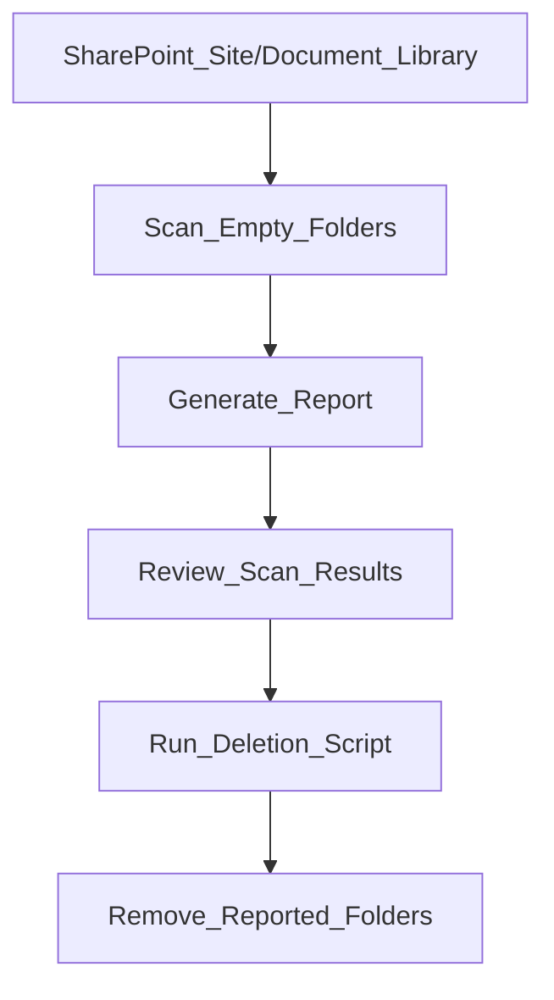

**SharePoint Empty Folder Cleanup**

[Full article] (https://fixr.cloud/delete-empty-folders-sharepoint-graph-powershell/)
</br></br>
**Safely identify and remove empty folders in SharePoint Online using Microsoft Graph PowerShell.**

This repository contains a two-step PowerShell solution to scan a specified SharePoint scope, identify empty folders—including nested child folders—and generate a report for review before deletion.

The solution separates the discovery and deletion processes to provide administrators with better visibility and control over SharePoint cleanup operations.
</br></br>

**Features**

- Scan a specified SharePoint site or document library scope.
- Identify empty folders, including nested directories.
- Generate a scan report for review.
- Keep scanning and deletion as separate operations.
- Use Microsoft Graph PowerShell to interact with SharePoint.
- Support a controlled cleanup workflow for large document libraries.
</br></br>
**How It Works**

The process follows two steps:


</br></br>
**Important:** The deletion script uses the scan report. It does not necessarily re-evaluate whether each folder is still empty immediately before deletion.

**Repository Contents**

| File                                |                            Description          |
|-----------------------------------|------------------------------------------------|
| Scan-EmptySharePointFolders.ps1     |       Scans the specified SharePoint scope and generates a report of empty folders. |
| Remove-EmptySharePointFolders.ps1   |       Processes the scan report and deletes the listed folders. |
| examples/sample-scan-report.csv     |       Example report is provided. |
</br></br>
**Prerequisites**
</br>
Before running the scripts, ensure you have:

- Access to the target SharePoint site or document library.
- The Microsoft Graph PowerShell module installed.
- Appropriate Microsoft Graph permissions and SharePoint access for the operations performed by the scripts.
- PowerShell environment configured for Microsoft Graph authentication.
</br>
Install Microsoft Graph PowerShell if it is not already available:

``` Install-Module Microsoft.Graph -Scope CurrentUser ```

The required permissions depend on the authentication method and operations used in the scripts. Review the permission requirements before executing them in production.

Usage
</br></br>
**Step 1 — Scan and Generate a Report**
</br>
Run the scan script:

.\scripts\Scan-EmptySharePointFolders.ps1
</br>
The script scans the specified SharePoint scope and identifies empty folders, including nested child folders.
</br>
The scan report should be reviewed before proceeding.
</br></br>
**Step 2 — Review the Report**
</br>
Before running the deletion script:
</br>
- Verify the SharePoint site and document library scope.
- Review the folders listed in the report.
- Confirm that the identified folders are safe to remove.
- Check whether any content has been added since the scan completed.
</br></br>
**Step 3 — Delete the Reported Folders**
</br>
After validating the report, run the deletion script:

.\scripts\Remove-EmptySharePointFolders.ps1
</br>
Note: Make sure update the exported scan report file name in the deletion script. Then It will revalidate and run in "DRY Mode" to double check the deletion directories/folders. However, this is optional you can skip it by executing below script directly, it will start delete the empty directories as per the scanned csv report.
</br>
.\scripts\Remove-EmptySharePointFolders.ps1 -ExecuteDeletion
</br>
The deletion script processes the folders listed in the scan report.
</br>
Update the script parameters or configuration as required for your environment.
</br></br>
⚠️ **Important Safety Considerations**
</br>
**The scan report represents a snapshot of the folder state at the time of scanning.**
</br>
If a user uploads a file or creates content in a folder after the scan completes, that folder may still be included in the report and could be deleted by the deletion script.
</br>
To reduce the risk of unintended deletion:

1. Run the scan during a low-activity window.
2. Review the report carefully before deletion.
3. Avoid concurrent changes to the targeted folders between scanning and deletion.
4. Use a test site or library before running the scripts in production.
5. Retain the scan report for auditing and troubleshooting.
</br>
Deleted SharePoint content may be recoverable through the SharePoint recycle bin, subject to applicable retention and recovery conditions. Do not rely on recycle bin recovery as a replacement for validating the deletion scope.
</br></br>
**Recommended Execution Approach**
</br>
For large SharePoint environments:

- Process one document library or directory scope at a time.
- Avoid running multiple cleanup operations against the same scope concurrently.
- Monitor execution and review the output.
- Keep the scan report associated with the corresponding cleanup operation.
</br>
This approach can help reduce execution time, simplify troubleshooting, and minimize disruption.
</br></br>
**Disclaimer**
This project is provided as-is for administrative and educational purposes.
</br>
Always test the scripts in a non-production environment before using them against production SharePoint data.
</br>
The repository author is not responsible for data loss, service disruption, or unintended changes resulting from the use of these scripts. Administrators are responsible for validating the target scope, permissions, and scan results before executing deletion operations.
</br></br>
**About**
Created by **Kiran Maji**
Microsoft 365 & Azure Administrator | Microsoft Certified
</br></br>
**Fixr.Cloud — Smarter IT, Simplified.**
</br>
For practical Microsoft 365, Azure, SharePoint, and identity administration insights, visit Fixr.Cloud.
